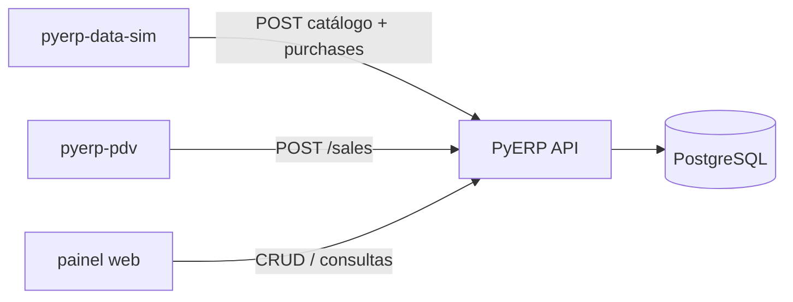

# PyERP — Contratos de integração

Documento canônico para apps externos (**Data Sim**, **PDV**) e para o painel do monorepo.  
A API deste repositório é o contrato; apps externos falam **só** por HTTP.

| Recurso | Onde |
|---------|------|
| Spec ao vivo | `GET http://localhost:8000/openapi.json` |
| Snapshot versionado | [`docs/openapi.json`](openapi.json) |
| Cópia do front (Tipos) | `frontend/openapi.json` → `npm run generate:api` |
| Regenerar snapshot | `python scripts/export_openapi.py` |
| Swagger | http://localhost:8000/docs |

**Regra de ouro:** o **catálogo de produtos vive no ERP**. Nenhum app externo mantém bank paralelo de SKUs. Ordem obrigatória:

```text
cadastrar no ERP (categorias, com hierarquia até folhas quando necessário
        → fornecedores com endereço completo
        → produtos com fornecedor principal e dados fiscais)
        → comprar (upload XML + confirm, com store_id)
        → vender (PDV: POST /sales, com estoque na loja)
```

---

## Ecossistema

| Componente | Repo | Papel |
|------------|------|--------|
| **API + painel web** | `pyerp` (este) | Contrato canônico; CRUD/consultas; catálogo no ERP |
| **Data Sim** | `pyerp-data-sim` (repo separado) | Gera fictícios e cadastra via API; XML de compra |
| **PDV** | `pyerp-pdv` (repo separado) | Simula caixa físico; vendas/cancelamento via API |

O painel em `frontend/` é console de desenvolvimento da API, não a UI final de produto. PDV de caixa não fica neste monorepo.



---

## Autenticação e escopo

### Login

```http
POST /auth/login
Content-Type: application/json

{ "login": "admin@pyerp.local", "password": "..." }
```

Resposta:

```json
{
  "access_token": "<jwt>",
  "token_type": "bearer",
  "expires_in": 28800
}
```

Todas as demais rotas (exceto health `/` e login) exigem:

```http
Authorization: Bearer <access_token>
```

### Contexto do usuário

```http
GET /auth/me
```

Retorna usuário + `company` + `default_branch` + `default_store` (quando configurados no seed/usuário).

| Campo | Origem | Uso pelos apps |
|-------|--------|----------------|
| `company_id` | JWT + usuário | Implícito em **todas** as queries; o client **não** envia `company_id` no body |
| `store_id` | Body/query **ou** `default_store_id` do usuário | Obrigatório em vendas, estoque e confirmação de compra |

Se `store_id` não vier na requisição e o usuário não tiver loja padrão → `422`.  
Loja de outra empresa / inativa → `422`.

Perfis sugeridos:

| App | Perfil mínimo | Por quê |
|-----|---------------|---------|
| Data Sim (catálogo + compras) | `conferente` ou `gerente` / `admin` | `products:write`, `suppliers:write`, `purchases:write`, `stock:read` |
| PDV (caixa) | `operador` | `sales:write`, `products:read`, `stock:read`; autentica com `pdv_id` (6 dígitos) + senha de login |
| PDV (desconto / cancelar) | `supervisor`+ | `sales:discount` / `sales:cancel`; override via PIN de 12 dígitos gerado no ERP |

Credenciais PDV são geradas **somente no ERP** (admin). O PDV nunca gera PIN. `pdv_id` ≠ `users.id`.

Matriz completa: [`INTERNO.md`](INTERNO.md#matriz-de-permissões).

---

## Endpoints obrigatórios — Data Sim

Config: `PYERP_API_URL` (ex. `http://localhost:8000`).

### Sessão

| Método | Path | Permissão |
|--------|------|-----------|
| `POST` | `/auth/login` | público — body: `login`, `password`, `company_document` (CNPJ) |
| `GET` | `/auth/me` | autenticado |

### Catálogo (cadastrar **antes** do XML)

| Método | Path | Permissão | Notas |
|--------|------|-----------|-------|
| `GET`/`POST` | `/categories/` | `categories:read` / `write` | Filtros: `q`, `is_active`, `offset`, `limit` |
| `GET` | `/categories/by-slug/{slug}` | `categories:read` | Lookup pela chave natural |
| `GET`/`POST` | `/suppliers/` | `suppliers:read` / `write` | Filtros: `name`, `document`, `active_only`, paginação |
| `GET` | `/suppliers/by-document/{document}` | `suppliers:read` | Aceita CNPJ com ou sem pontuação |
| `GET`/`POST` | `/products/` | `products:read` / `write` | Filtros: `q`, `sku`, `barcode`, `material_code`, `category_id`, `primary_supplier_id`, `is_active`, paginação |
| `GET` | `/products/by-sku/{sku}` | `products:read` | Lookup pela chave natural |
| `GET` | `/products/by-barcode/{barcode}` | `products:read` | Lookup por EAN/código de barras |

Os endpoints de listagem retornam uma página (`items`, `total`, `offset`, `limit`). Os lookups
`by-*` retornam `404` quando a chave não existe.

#### Payloads de criação

Categoria:

```json
{
  "name": "Bebidas",
  "slug": "bebidas",
  "is_active": true
}
```

Fornecedor:

```json
{
  "name": "Fornecedor Exemplo Ltda.",
  "trade_name": "Fornecedor Exemplo",
  "document": "11.222.333/0001-81",
  "state_registration": "123456789",
  "email": "fiscal@example.com",
  "phone": "11999999999",
  "is_active": true,
  "address": {
    "description": "Principal",
    "zip_code": "01310100",
    "street": "Avenida Paulista",
    "number": "1000",
    "complement": "Sala 1",
    "neighborhood": "Bela Vista",
    "city": "São Paulo",
    "state": "SP",
    "ibge_code": "3550308"
  }
}
```

O endereço principal completo é obrigatório na criação. O CNPJ é normalizado para
14 dígitos e validado pelos dígitos verificadores. O backend gera `code` com 8 dígitos;
o cliente não envia nem altera esse campo.

Produto:

```json
{
  "name": "Café 500 g",
  "sku": "CAFE-500",
  "barcode": "7891234567890",
  "description": "Café torrado e moído",
  "cost_price": "12.50",
  "sale_price": "18.90",
  "weight_net": "0.500",
  "weight_gross": "0.520",
  "unit_of_measure": "UN",
  "category_id": 1,
  "primary_supplier_id": 1,
  "is_active": true,
  "fiscal": {
    "ncm": "09012100",
    "cest": "1709600",
    "cfop_default": "5102",
    "origem_produto": 0
  }
}
```

`primary_supplier_id` é obrigatório e deve referenciar um fornecedor já cadastrado.
O backend gera `material_code` com 7 dígitos; clientes não podem defini-lo ou alterá-lo.
`sale_price` deve ser maior que zero. `ncm` exige 8 dígitos, `cfop_default` 4,
`cest` 7 quando informado e `origem_produto` deve estar entre 0 e 8.
As respostas incluem `id`; use `product_id` no mapeamento da compra.

#### Idempotência e erros do catálogo

Antes de criar, o Data Sim deve consultar a chave natural com `GET by-*`. Em replay
ou corrida concorrente, trate:

| HTTP | Situação |
|------|----------|
| `404` | Lookup não encontrou o cadastro |
| `409` | Slug, SKU/EAN ou CNPJ já existe na empresa |
| `422` | Payload ou dados fiscais/CNPJ inválidos |

### Compras (NF-e)

| Método | Path | Permissão | Notas |
|--------|------|-----------|-------|
| `POST` | `/purchases/upload-xml` | `purchases:write` | `multipart/form-data`, campo `file` |
| `POST` | `/purchases/confirm` | `purchases:write` | Body JSON; preferir itens **já mapeados** a produtos cadastrados |
| `GET` | `/purchases/` | `purchases:read` | Conferência |
| `GET` | `/purchases/{id}` | `purchases:read` | Detalhe |

Fluxo:

1. Gerar XML com códigos/EAN/SKU **já existentes** no ERP (ou mapear no confirm).
2. `POST /purchases/upload-xml` → preview (`supplier`, `invoice`, `items[]` com `mapping_status`, `suggested_product_id`). `supplier.address` recebe os campos disponíveis de `emit/enderEmit`; campos ausentes são `null` e não impedem o preview.
3. Montar `PurchaseConfirmRequest` a partir do preview:
   - `access_key`, `invoice_number`, `invoice_series`, `issue_date`
   - `supplier_id` **ou** `create_supplier: true` + dados do emitente; não envie ambos
   - ao criar, `supplier_address` é obrigatório e deve conter CEP, logradouro, número, bairro, cidade, UF e código IBGE válidos. Copie-o do preview e complete/corrija os campos ausentes antes de confirmar
   - `store_id` (loja que recebe o estoque)
   - `items[]`: `product_id` preenchido quando `mapped`; senão `create_product` (evitar no fluxo feliz do Data Sim — prefira cadastrar antes)
4. `POST /purchases/confirm` → `201` + pedido; estoque da loja sobe; custo médio atualiza.

Mapeamento automático no preview (ordem): de-para fornecedor → barcode → SKU = código do fornecedor.
Fornecedor já existente na empresa é reutilizado pelo ID ou CNPJ normalizado, sem alteração do endereço pelo XML. Se o emitente ainda não existir, CNPJ e endereço são validados pelo mesmo domínio do cadastro de fornecedores; XML incompleto sem complementação de `supplier_address` recebe `422` e não persiste a compra nem entidades intermediárias.

---

## Endpoints obrigatórios — PDV

Config: `PYERP_API_URL` + usuário com `default_store_id` ou envio explícito de `store_id`.

### Sessão e organização

| Método | Path | Permissão |
|--------|------|-----------|
| `POST` | `/auth/pdv-login` | público — `company_document` + `pdv_id` (6 dígitos) + senha de login |
| `POST` | `/auth/pdv-authorize` | `sales:write` — Supervisor+ via `pdv_id` + PIN 12 dígitos; ações `discount`/`cancel` |
| `GET` | `/auth/me` | autenticado (obter `default_store`, `pdv_id`) |
| `GET` | `/stores/` | listar lojas da empresa (opcional UI) |

### Produto e estoque

| Método | Path | Permissão | Notas |
|--------|------|-----------|-------|
| `GET` | `/products/` | `products:read` | Busca/listagem (`q`, `sku`, `barcode`, …) |
| `GET` | `/products/by-sku/{sku}` | `products:read` | Lookup direto no caixa |
| `GET` | `/products/by-barcode/{barcode}` | `products:read` | Leitura de EAN |
| `GET` | `/products/{id}` | `products:read` | Detalhe / preço |
| `GET` | `/stock/product/{product_id}/balance?store_id=` | `stock:read` | Saldo na loja do caixa |

### Vendas

| Método | Path | Permissão | Notas |
|--------|------|-----------|-------|
| `POST` | `/sales/` | `sales:write` | Carrinho → venda; `discount_amount` exige Supervisor+ ou token |
| `GET` | `/sales/` | `sales:read` | Histórico |
| `GET` | `/sales/{id}` | `sales:read` | Cupom/detalhe |
| `POST` | `/sales/{id}/cancel` | `sales:write` | Estorno; sem `sales:cancel` exige `supervisor_authorization` |

Body de criação:

```json
{
  "customer_id": null,
  "payment_method": "dinheiro",
  "store_id": 1,
  "discount_amount": "0.00",
  "supervisor_authorization": null,
  "items": [
    { "product_id": 10, "quantity": 2 }
  ]
}
```

Override de Supervisor+ (desconto/cancelamento): o caixa chama `POST /auth/pdv-authorize` com o `pdv_id` e o PIN do supervisor (digitado ou bipado) e envia o `authorization_token` em `supervisor_authorization`. O PIN **não** é gerado no PDV.

Preço vem do cadastro do produto no ERP (não envie preço unitário no MVP).

Erros que o PDV deve tratar:

| HTTP | Situação |
|------|----------|
| `401` | Token inválido/expirado → re-login |
| `403` | Perfil sem permissão (ex.: operador tentando cancelar) |
| `404` | Produto/venda inexistente **nesta empresa** |
| `409` | Estoque insuficiente (`InsufficientStockException`) |
| `422` | Payload inválido / `store_id` ausente |

**Só vende SKU já cadastrado no ERP** e com saldo na loja (salvo regras futuras). Estoque idealmente vem de compra confirmada (Data Sim) ou CRUD/ajuste no mockup.

---

## Fluxo demo ponta a ponta

```text
1. Data Sim: login → POST categories (hierarquia até folhas, se necessária) → suppliers (endereço completo) → products (fornecedor principal + fiscal)
2. Data Sim: GET by-slug / by-sku / by-document → mesmo id
3. Replay das chaves naturais → 409; NCM/CNPJ inválidos → 422
4. Data Sim: gera XML alinhado aos EAN/SKU → upload-xml → confirm (store_id)
5. Conferir: GET /stock/product/{id}/balance?store_id=…
6. PDV: login (operador) → by-barcode/by-sku → POST /sales
7. Mockup PyERP: GET /sales e GET /products para auditar
```

Aceite mínimo do ecossistema: produto criado pelo Data Sim aparece em `GET /products` e nos lookups `by-*`; compra confirmada mexe estoque; venda do PDV aparece em `GET /sales` e baixa estoque.

---

## Fora de escopo deste contrato

- Implementação dos repos `pyerp-data-sim` / `pyerp-pdv` (Épicos D e E)
- Emissão fiscal real / SEFAZ
- Bank de fixtures versionado neste monorepo (removido no Épico A)
- PDV embutido no Next.js do core (removido no Épico C; PDV = repo `pyerp-pdv`)

---

## Checklist para integradores

- [ ] Leu este doc + abriu `/docs` ou `docs/openapi.json`
- [ ] Auth com Bearer em todas as chamadas pós-login
- [ ] Não inventa `company_id` no client — vem do token
- [ ] Envia ou resolve `store_id` em compra / venda / saldo
- [ ] Data Sim: login e cadastro na ordem categorias (até folhas) → fornecedores com endereço completo → produtos com fornecedor principal/fiscal
- [ ] Cada cadastro criado é recuperado pelo respectivo `GET by-*` com o mesmo `id`
- [ ] Replay das chaves naturais recebe `409`, sem duplicata silenciosa
- [ ] Produto fiscal inválido recebe `422`; produto válido persiste NCM/CEST/CFOP/origem
- [ ] CNPJ inválido recebe `422`; fornecedor válido persiste inscrição estadual
- [ ] Data Sim: **cadastra produto no ERP antes** de XML/venda
- [ ] Opcional: XML de compra usa SKU/EAN já cadastrado e o preview encontra o produto
- [ ] PDV: trata `409` de estoque e `403` de cancelamento
- [ ] Spec regenerada com `python scripts/export_openapi.py` quando a API mudar

*Épicos de cadastros e contratos de integração · julho/2026*
