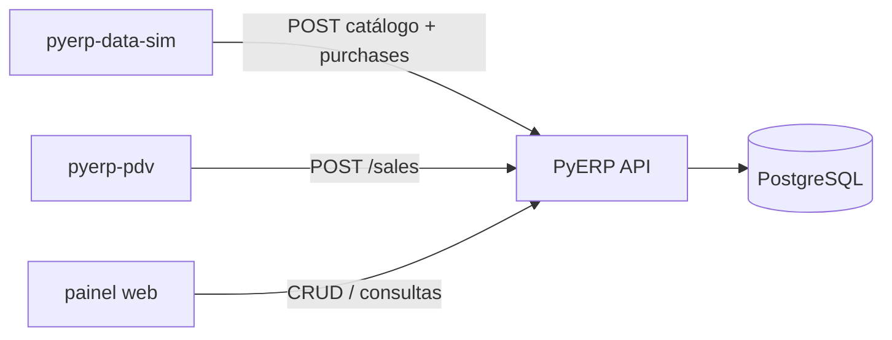

# PyERP — Contratos de integração

Documento canônico para apps externos (**Data Sim**, **PDV**) e para o painel do monorepo.  
A API deste repositório é o contrato; apps externos falam **só** por HTTP.

| Recurso | Onde |
|---------|------|
| Spec ao vivo | `GET http://localhost:8000/openapi.json` |
| Snapshot versionado | [`docs/openapi.json`](openapi.json) |
| Cópia do front (Tipos) | `frontend/openapi.json` → `npm run generate:api` |
| Regenerar snapshot | `python scripts/export_openapi.py` |
| Swagger | http://localhost:8000/docs |

**Regra de ouro:** o **catálogo de produtos vive no ERP**. Nenhum app externo mantém bank paralelo de SKUs. Ordem obrigatória:

```text
cadastrar no ERP (categorias → marcas → produtos → fornecedores)
        → comprar (upload XML + confirm, com store_id)
        → vender (PDV: POST /sales, com estoque na loja)
```

---

## Ecossistema

| Componente | Repo | Papel |
|------------|------|--------|
| **API + painel web** | `pyerp` (este) | Contrato canônico; CRUD/consultas; catálogo no ERP |
| **Data Sim** | `pyerp-data-sim` (repo separado) | Gera fictícios e cadastra via API; XML de compra |
| **PDV** | `pyerp-pdv` (repo separado) | Simula caixa físico; vendas/cancelamento via API |

O painel em `frontend/` é console de desenvolvimento da API, não a UI final de produto. PDV de caixa não fica neste monorepo.



---

## Autenticação e escopo

### Login

```http
POST /auth/login
Content-Type: application/json

{ "login": "admin@pyerp.local", "password": "..." }
```

Resposta:

```json
{
  "access_token": "<jwt>",
  "token_type": "bearer",
  "expires_in": 28800
}
```

Todas as demais rotas (exceto health `/` e login) exigem:

```http
Authorization: Bearer <access_token>
```

### Contexto do usuário

```http
GET /auth/me
```

Retorna usuário + `company` + `default_branch` + `default_store` (quando configurados no seed/usuário).

| Campo | Origem | Uso pelos apps |
|-------|--------|----------------|
| `company_id` | JWT + usuário | Implícito em **todas** as queries; o client **não** envia `company_id` no body |
| `store_id` | Body/query **ou** `default_store_id` do usuário | Obrigatório em vendas, estoque e confirmação de compra |

Se `store_id` não vier na requisição e o usuário não tiver loja padrão → `422`.  
Loja de outra empresa / inativa → `422`.

Perfis sugeridos:

| App | Perfil mínimo | Por quê |
|-----|---------------|---------|
| Data Sim (catálogo + compras) | `conferente` ou `gerente` / `admin` | `products:write`, `suppliers:write`, `purchases:write`, `stock:read` |
| PDV (caixa) | `operador` | `sales:write`, `products:read`, `stock:read` |
| PDV (cancelar venda) | `supervisor`+ | `sales:cancel` |

Matriz completa: [`INTERNO.md`](INTERNO.md#matriz-de-permissões).

---

## Endpoints obrigatórios — Data Sim

Config: `PYERP_API_URL` (ex. `http://localhost:8000`).

### Sessão

| Método | Path | Permissão |
|--------|------|-----------|
| `POST` | `/auth/login` | público |
| `GET` | `/auth/me` | autenticado |

### Catálogo (cadastrar **antes** do XML)

| Método | Path | Permissão | Notas |
|--------|------|-----------|-------|
| `GET`/`POST` | `/categories/` | `categories:read` / `write` | Criar setores da loja |
| `GET`/`POST` | `/brands/` | `brands:read` / `write` | Opcional por produto |
| `GET`/`POST` | `/products/` | `products:read` / `write` | SKU/EAN devem bater com o XML depois |
| `GET`/`POST` | `/suppliers/` | `suppliers:read` / `write` | CNPJ 14 dígitos; pode criar na confirm se `create_supplier` |

`POST /products/` (campos principais): `name`, `sku`, `barcode?`, `cost_price`, `sale_price`, `unit_of_measure`, `category_id`, `brand_id?`, `fiscal?` (`ncm`, `cfop_default`, …).

Resposta inclui `id` — use esse `product_id` no mapeamento da compra.

### Compras (NF-e)

| Método | Path | Permissão | Notas |
|--------|------|-----------|-------|
| `POST` | `/purchases/upload-xml` | `purchases:write` | `multipart/form-data`, campo `file` |
| `POST` | `/purchases/confirm` | `purchases:write` | Body JSON; preferir itens **já mapeados** a produtos cadastrados |
| `GET` | `/purchases/` | `purchases:read` | Conferência |
| `GET` | `/purchases/{id}` | `purchases:read` | Detalhe |

Fluxo:

1. Gerar XML com códigos/EAN/SKU **já existentes** no ERP (ou mapear no confirm).
2. `POST /purchases/upload-xml` → preview (`supplier`, `invoice`, `items[]` com `mapping_status`, `suggested_product_id`).
3. Montar `PurchaseConfirmRequest` a partir do preview:
   - `access_key`, `invoice_number`, `invoice_series`, `issue_date`
   - `supplier_id` **ou** `create_supplier: true` + dados do emitente
   - `store_id` (loja que recebe o estoque)
   - `items[]`: `product_id` preenchido quando `mapped`; senão `create_product` (evitar no fluxo feliz do Data Sim — prefira cadastrar antes)
4. `POST /purchases/confirm` → `201` + pedido; estoque da loja sobe; custo médio atualiza.

Mapeamento automático no preview (ordem): de-para fornecedor → barcode → SKU = código do fornecedor.

---

## Endpoints obrigatórios — PDV

Config: `PYERP_API_URL` + usuário com `default_store_id` ou envio explícito de `store_id`.

### Sessão e organização

| Método | Path | Permissão |
|--------|------|-----------|
| `POST` | `/auth/login` | público |
| `GET` | `/auth/me` | autenticado (obter `default_store`) |
| `GET` | `/stores/` | listar lojas da empresa (opcional UI) |

### Produto e estoque

| Método | Path | Permissão | Notas |
|--------|------|-----------|-------|
| `GET` | `/products/` | `products:read` | Busca/listagem de SKU |
| `GET` | `/products/{id}` | `products:read` | Detalhe / preço |
| `GET` | `/stock/product/{product_id}/balance?store_id=` | `stock:read` | Saldo na loja do caixa |

### Vendas

| Método | Path | Permissão | Notas |
|--------|------|-----------|-------|
| `POST` | `/sales/` | `sales:write` | Carrinho → venda concluída |
| `GET` | `/sales/` | `sales:read` | Histórico |
| `GET` | `/sales/{id}` | `sales:read` | Cupom/detalhe |
| `POST` | `/sales/{id}/cancel` | `sales:cancel` | Estorno de estoque |

Body de criação:

```json
{
  "customer_id": null,
  "payment_method": "dinheiro",
  "store_id": 1,
  "items": [
    { "product_id": 10, "quantity": 2 }
  ]
}
```

Preço vem do cadastro do produto no ERP (não envie preço unitário no MVP).

Erros que o PDV deve tratar:

| HTTP | Situação |
|------|----------|
| `401` | Token inválido/expirado → re-login |
| `403` | Perfil sem permissão (ex.: operador tentando cancelar) |
| `404` | Produto/venda inexistente **nesta empresa** |
| `409` | Estoque insuficiente (`InsufficientStockException`) |
| `422` | Payload inválido / `store_id` ausente |

**Só vende SKU já cadastrado no ERP** e com saldo na loja (salvo regras futuras). Estoque idealmente vem de compra confirmada (Data Sim) ou CRUD/ajuste no mockup.

---

## Fluxo demo ponta a ponta

```text
1. Data Sim: login → POST categories/brands/products/suppliers
2. Data Sim: gera XML alinhado aos EAN/SKU → upload-xml → confirm (store_id)
3. Conferir: GET /stock/product/{id}/balance?store_id=…
4. PDV: login (operador) → busca produto → POST /sales
5. Mockup PyERP: GET /sales e GET /products para auditar
```

Aceite mínimo do ecossistema: produto criado pelo Data Sim aparece em `GET /products`; compra confirmada mexe estoque; venda do PDV aparece em `GET /sales` e baixa estoque.

---

## Fora de escopo deste contrato

- Implementação dos repos `pyerp-data-sim` / `pyerp-pdv` (Épicos D e E)
- Emissão fiscal real / SEFAZ
- Bank de fixtures versionado neste monorepo (removido no Épico A)
- PDV embutido no Next.js do core (removido no Épico C; PDV = repo `pyerp-pdv`)

---

## Checklist para integradores

- [ ] Leu este doc + abriu `/docs` ou `docs/openapi.json`
- [ ] Auth com Bearer em todas as chamadas pós-login
- [ ] Não inventa `company_id` no client — vem do token
- [ ] Envia ou resolve `store_id` em compra / venda / saldo
- [ ] Data Sim: **cadastra produto no ERP antes** de XML/venda
- [ ] PDV: trata `409` de estoque e `403` de cancelamento
- [ ] Spec regenerada com `python scripts/export_openapi.py` quando a API mudar

*Épico B — Contratos de integração · julho/2026*
