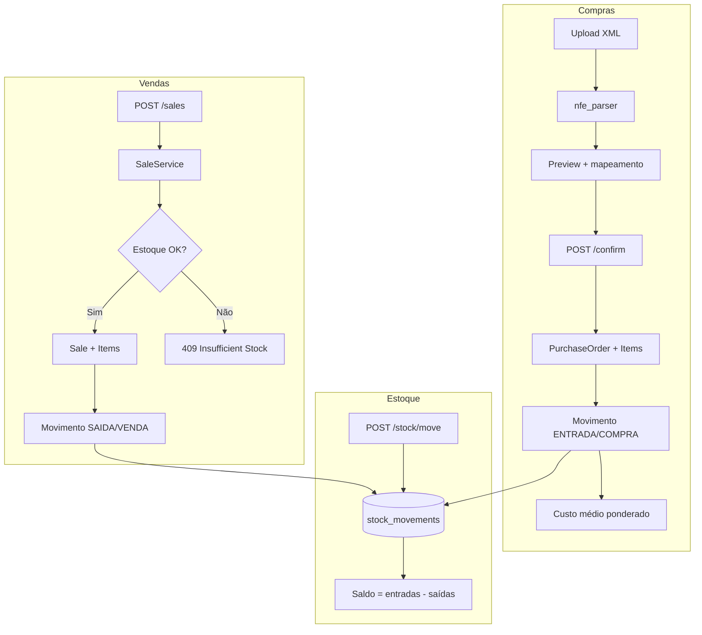

# PyERP — Documentação Interna

> Uso exclusivo da equipe de desenvolvimento. Para onboarding rápido, comece pelo [README](../README.md).

---

## Visão geral

PyERP é uma API REST (FastAPI) para operações de varejo alimentar brasileiro. Cobre o ciclo básico de um ERP: cadastro, venda, estoque, compra via NF-e e relatórios. O escopo é acadêmico/de demonstração — não há integração com SEFAZ, gateways de pagamento ou filas.

### Ecosistema

| Papel | Onde |
|-------|------|
| API + painel web (catálogo no ERP) | este monorepo |
| Geração/cadastro de dados fictícios + XML de compra | repo externo **pyerp-data-sim** |
| Simulação de PDV / caixa físico | repo externo **pyerp-pdv** |

Contrato para integradores: [`INTEGRACOES.md`](INTEGRACOES.md) · OpenAPI: [`openapi.json`](openapi.json) (`python scripts/export_openapi.py`).

### Stack

| Camada        | Tecnologia                          |
|---------------|-------------------------------------|
| API           | FastAPI + Uvicorn                   |
| ORM           | SQLModel (SQLAlchemy 2.x)           |
| Banco         | PostgreSQL 16                       |
| Migrações     | Alembic                             |
| Auth          | JWT (`python-jose`) + bcrypt        |
| Frontend      | Next.js 15 + TypeScript + shadcn/ui |
| Testes        | pytest + httpx (TestClient)         |
| Infra local   | Docker Compose (Postgres + pgAdmin) |

---

## Arquitetura em camadas

```
HTTP Request
    ↓
Router          validação Pydantic, auth via Depends
    ↓
Service         regras de negócio, transações, auditoria
    ↓
Repository      queries SQLModel (sem lógica de negócio)
    ↓
Model           tabelas + schemas Create/Update/Response
    ↓
PostgreSQL
```

### Responsabilidades por camada

**Routers** (`routers/`) — 15 módulos montados. Recebem requisições, injetam `Session` via `get_db`, protegem rotas com `require_permission("modulo:acao")`.

**Services** (`services/`) — 14 módulos de domínio (+ `exceptions`). Contêm a lógica de negócio, coordenam repositórios, lançam exceções e registram auditoria.

**Repositories** (`repositories/`) — Classes estáticas com queries. Sem regra de negócio.

**Models** (`models/`) — SQLModel unifica ORM e schemas. Enums compartilhados em `utils/enums.py`.

### Tratamento de erros

`exception_handlers.py` mapeia exceções customizadas:

| Exceção                      | HTTP |
|------------------------------|------|
| `ResourceNotFoundException`  | 404  |
| `ValidationError`            | 422  |
| `InsufficientStockException` | 409  |
| `ConflictException`          | 409  |
| `BusinessRuleException`      | 400  |
| `UnauthorizedException`      | 401  |
| `ForbiddenException`         | 403  |

---

## Módulos de negócio

### Autenticação (`/auth`)

- `POST /auth/login` — público, retorna JWT
- `GET /auth/me` — usuário + empresa + filial/loja padrão
- `POST /auth/change-password` — troca a própria senha

Token JWT contém `sub` (user_id), `profile` e `company_id`. Expiração configurável via `JWT_EXPIRE_HOURS`.

### Organização (tenant)

| Módulo   | Prefixo        | Observações                                      |
|----------|----------------|--------------------------------------------------|
| Empresa  | `/companies`   | `GET /me` — empresa do token                     |
| Filiais  | `/branches`    | CRUD escopado à empresa                          |
| Lojas    | `/stores`      | CRUD; vendas/estoque/compras usam `store_id`     |

Seed: 1 empresa (PyERP Demo Ltda) → 1 filial (Matriz) → 1 loja (Loja Centro). Cadastros mestres têm `company_id`; operações têm `company_id` + `store_id`. Isolamento: recurso de outra empresa → 404.

### Usuários (`/users`) — somente admin

CRUD. Perfis disponíveis: `admin`, `gerente`, `supervisor`, `operador`, `conferente`, `colaborador`.

### Catálogo

| Módulo      | Prefixo        | Observações                          |
|-------------|----------------|--------------------------------------|
| Categorias  | `/categories`  | CRUD, detalhe com produtos           |
| Marcas      | `/brands`      | CRUD                                 |
| Produtos    | `/products`    | CRUD + dados fiscais (NCM, CFOP)     |
| Clientes    | `/customers`   | CRUD + endereços aninhados           |
| Fornecedores| `/suppliers`   | CRUD, CNPJ normalizado (14 dígitos)  |

### Vendas (`/sales`)

Fluxo em `SaleService.process_sale()`:

1. Valida itens, cliente e estoque
2. Cria `Sale` + `SaleItem` com status `CONCLUIDA`
3. Registra movimentação `SAIDA` / motivo `VENDA`
4. Commit atômico

Cancelamento (`POST /sales/{id}/cancel`):

- Estorna estoque com `ENTRADA` / motivo `DEVOLUCAO`
- Muda status para `CANCELADA`
- Requer permissão `sales:cancel` (admin, gerente, supervisor)

### Estoque (`/stock`)

**Não existe tabela `stock`.** O saldo é calculado:

```
saldo = SUM(entradas) - SUM(saídas)
```

Movimentações manuais via `POST /stock/move`. Vendas e compras geram movimentos automaticamente.

Motivos de movimentação: `venda`, `compra`, `ajuste`, `devolucao`.

### Compras (`/purchases`)

Fluxo principal:

```
POST /purchases/upload-xml  →  parse NF-e  →  preview com mapeamento
POST /purchases/confirm     →  cria pedido  →  entrada de estoque  →  custo médio
POST /purchases/{id}/cancel →  estorna estoque (se saldo permitir)
```

**Mapeamento automático de produtos** (ordem de prioridade):

1. `SupplierProductMapping` (código do fornecedor)
2. Código de barras
3. SKU = código do fornecedor

**Custo unitário de entrada** (parser NF-e): preço − desconto + IPI + ICMS-ST, dividido pela quantidade.

Na confirmação, produtos não mapeados podem ser criados inline (margem padrão 35% sobre o custo).

### Relatórios (`/reports`)

- `GET /reports/top-products` — mais vendidos por quantidade
- `GET /reports/average-ticket` — ticket médio
- `GET /reports/critical-stock` — abaixo de threshold (padrão: 5)

### Auditoria (`/audit-log`) — somente admin

Registra ações: `CREATE`, `UPDATE`, `DELETE`, `STOCK_MOVE`, `PASSWORD_CHANGE`, `ROLE_CHANGE`. Detalhes em JSONB.

---

## Matriz de permissões

Formato: `modulo:acao` (ex.: `sales:write`, `purchases:read`).

| Módulo     | admin | gerente | supervisor | operador | conferente | colaborador |
|------------|-------|---------|------------|----------|------------|-------------|
| categories | R/W   | R/W     | R          | R        | R          | R           |
| brands     | R/W   | R/W     | R          | R        | R          | R           |
| products   | R/W   | R/W     | R          | R        | R          | R           |
| customers  | R/W   | R/W     | R          | R/W      | R          | R           |
| sales      | R/W/C | R/W/C   | R/W/C      | R/W      | R          | R           |
| stock      | R/W   | R/W     | R/W        | R        | R/W        | R           |
| reports    | R     | R       | R          | R        | R          | R           |
| users      | R/W   | —       | —          | —        | —          | —           |
| audit      | R     | —       | —          | —        | —          | —           |
| suppliers  | R/W   | R/W     | R          | R        | R          | R           |
| purchases  | R/W   | R/W     | R          | R        | R/W        | R           |
| companies  | R     | R       | R          | R        | R          | R           |
| branches   | R/W   | R/W     | R          | R        | R          | R           |
| stores     | R/W   | R/W     | R          | R        | R          | R           |

R = read, W = write, C = cancel (vendas).

Definição completa em `auth/permissions.py`.

---

## Banco de dados

### Entidades (18 tabelas de negócio + `alembic_version`)

| Tabela                      | Papel                                    |
|-----------------------------|------------------------------------------|
| `companies`, `branches`, `stores` | Tenant: empresa → filial → loja   |
| `users`                     | Autenticação e perfis (`company_id`)     |
| `audit_log`                 | Trilha de auditoria                      |
| `categories`, `brands`      | Segmentação do catálogo                  |
| `products`, `product_fiscals` | SKU, preços, dados fiscais             |
| `customers`, `customer_addresses` | Clientes PF/PJ + endereços         |
| `sales`, `sale_items`       | Vendas                                   |
| `stock_movements`           | Ledger de estoque                        |
| `suppliers`                 | Fornecedores                             |
| `purchase_orders`, `purchase_items` | Compras via NF-e                 |
| `supplier_product_mappings` | De-para código fornecedor → produto      |

### Migrações

Alembic é a fonte de verdade. Quatro revisões:

1. `e9a45e47d010` — schema inicial
2. `a1b2c3d4e5f6` — users, audit, colunas created_by/updated_by
3. `b2c3d4e5f6a7` — suppliers, purchases, mappings
4. `c3d4e5f6a7b8` — companies, branches, stores (tenant)

Na subida (`init_db()`): `alembic upgrade head` + seed do admin/org demo.

Não há migrações SQL legadas no repositório.

Se o banco já tem tabelas mas falta `alembic_version`, a API levanta erro orientando recriar o volume (`docker compose down -v`).

### Seed

- **Automático:** organização demo (empresa/filial/loja) + usuário admin (`ADMIN_PASSWORD` **obrigatório** no `.env`)
- **Testes:** `tests/catalog_seed.py` cria produtos mínimos alinhados a `tests/fixtures/nfe/`
- **Dados fictícios:** bank acadêmico saiu do monorepo; CI usa apenas `tests/fixtures/nfe/`

---

## Startup e variáveis de ambiente

| Variável            | Descrição                              |
|---------------------|----------------------------------------|
| `DATABASE_URL`      | Conexão PostgreSQL principal           |
| `TEST_DATABASE_URL` | Banco de testes                        |
| `SQL_ECHO`          | Log de queries SQL                     |
| `JWT_SECRET`        | Chave do token (obrigatório em produção) |
| `JWT_EXPIRE_HOURS`  | Expiração do JWT (padrão: 8h)          |
| `ADMIN_*`           | Credenciais do seed do admin           |
| `CORS_ORIGINS`      | Origens CORS (vírgula); default localhost:3000 |
| `LOGIN_RATE_LIMIT`  | Máx. tentativas de login por IP na janela (default 10) |
| `LOGIN_RATE_WINDOW_SECONDS` | Janela do rate limit de login (default 60s) |
| `ENV`               | `development` / `production` (gates de segurança) |

---

## Testes

**114 testes** de integração com PostgreSQL real via `TestClient`.

```
tests/
├── conftest.py              # DB, clientes por perfil (6 perfis), fixtures pytest
├── catalog_seed.py          # Seed mínimo para compras/XML
├── test_auth.py             # Login, JWT, troca de senha
├── test_security.py         # JWT/admin em produção + CORS
├── test_users.py            # CRUD de usuários
├── test_permissions.py      # RBAC — todos os 6 perfis
├── test_tenant_isolation.py # Isolamento company_id / store_id
├── test_categories.py       # CRUD + delete com produtos (409)
├── test_brands.py           # CRUD + delete com produtos (409)
├── test_products.py         # CRUD, fiscal, hard delete, Decimal
├── test_customers.py        # CRUD + endereços
├── test_audit.py            # Listagem, filtros (incl. date), paginação
├── test_sales.py            # Venda, cancelamento, concorrência
├── test_purchases.py        # NF-e, confirmação, list/detail, date filters
├── test_stock.py            # Entrada, saída, saldo, extrato
├── test_nfe_parser.py       # Parser unitário
├── test_reports.py          # Relatórios
├── test_migrations.py       # Schema Alembic completo (incl. tenant)
└── fixtures/nfe/            # Subset CI de XMLs
```

CI: `.github/workflows/ci.yml` — pytest + ruff (backend) e `npm run lint` + `npm run build` (frontend, Node 22).

### Lacunas conhecidas

- Refresh token / JWT em cookie httpOnly (opcionais)
- Frontend sem testes automatizados de UI (CI cobre lint + build)
- Ver: `docs/QA-BACKLOG-SQUAD.md`

---

## Convenções de código

### Comentários

Seguimos estas regras (após limpeza de rastros de IA):

- **Não comentar o óbvio** — se o código já diz o que faz, o comentário é ruído
- **Comentar regras de negócio não triviais** — ex.: `brand_id == 0` tratado como `None` em `ProductService`
- **Docstrings de módulo** apenas quando o contexto não é claro — ex.: `nfe_parser.py` (layout 4.00)
- **Schemas de API** documentados via `Field(description=...)` em português, não via docstrings em classes DTO
- **Sem docstrings boilerplate** em services e repositories — o nome da classe já comunica

### Idioma

- Mensagens de API e campos de schema: **português**
- Código (nomes de variáveis, classes, métodos): **inglês**
- Documentação: **português**

### Padrões transversais

- Hard delete nos cadastros (`DELETE` remove o registro; 409 se houver vínculos)
- Campo `is_active` pode ser usado em updates para desativar sem excluir
- `created_by` / `updated_by` em entidades de cadastro
- Auditoria via `AuditService.log()` nos **services** (category, brand, customer, product, sale, purchase, etc.)
- Transações com `commit`/`rollback` explícitos nos services

---

## Diagrama de fluxos principais



---

## Endpoints — referência rápida

Total: **64** endpoints de negócio + health + OpenAPI.

| Prefixo        | Endpoints principais                                      |
|----------------|-----------------------------------------------------------|
| `/`            | Health check                                              |
| `/auth`        | login, me, change-password                                |
| `/companies`   | me (empresa do token)                                     |
| `/branches`    | CRUD filiais                                              |
| `/stores`      | CRUD lojas                                                |
| `/users`       | CRUD + reset senha                                        |
| `/audit-log`   | listagem com filtros                                      |
| `/products`    | CRUD                                                      |
| `/categories`  | CRUD + detalhe com produtos                               |
| `/brands`      | CRUD                                                      |
| `/customers`   | CRUD + endereços                                          |
| `/sales`       | listar, criar, cancelar                                   |
| `/stock`       | movimentar, saldo, extrato                                |
| `/reports`     | top produtos, ticket médio, estoque crítico               |
| `/suppliers`   | CRUD                                                      |
| `/purchases`   | upload-xml, confirm, listar, detalhe, cancelar            |

Documentação interativa: `/docs` (Swagger) e `/redoc`.  
Contrato de integração (Data Sim / PDV): [`INTEGRACOES.md`](INTEGRACOES.md). Snapshot: [`openapi.json`](openapi.json).

---

## Painel web (`frontend/`)

Console Next.js 15 para testar a API: login JWT em `localStorage`, sidebar filtrada por perfil (RBAC), seletor de loja e CRUD/consulta dos módulos. Empresa aparece só leitura via `/auth/me` — não há tela de cadastro de empresa. Detalhes em [`frontend/README.md`](../frontend/README.md).

---

## Histórico e decisões

- **CLI removida** — a API REST é o único ponto de entrada do backend
- **Estoque por movimentação** — evita inconsistência entre saldo e histórico
- **NF-e simulada** — parser local, sem SEFAZ; XMLs de CI em `tests/fixtures/nfe/`
- **Dados fictícios fora do monorepo** — bank acadêmico foi removido; subset CI permanece em `tests/fixtures/nfe/`
- **Apps externos** — Data Sim e PDV em repos Git separados; integração só por HTTP
- **Painel = console de API** — UI final de caixa fica no PDV
- **Alembic como fonte do schema** — `create_all()` e SQL legado não rodam no startup
- **RBAC por perfil** — permissões granulares por módulo

---

*Última atualização: julho/2026*
